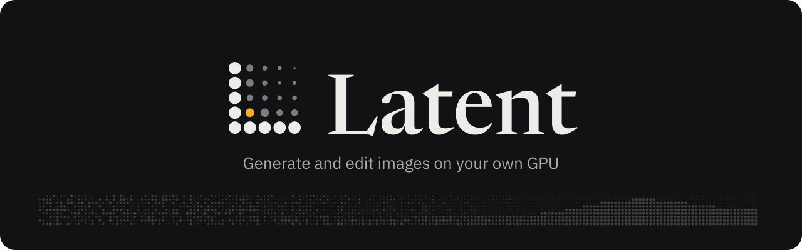
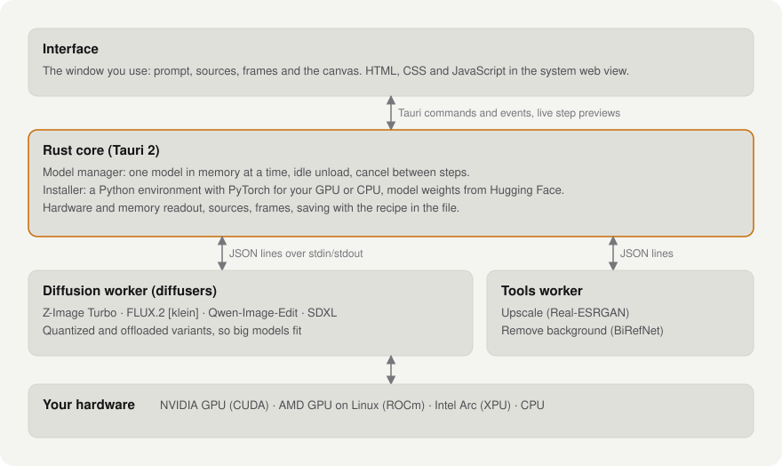

<div align="center">

<picture>
  <source media="(prefers-color-scheme: dark)" srcset="docs/assets/brand/banner-dark.svg">
  <source media="(prefers-color-scheme: light)" srcset="docs/assets/brand/banner-light.svg">
  
</picture>

**Write a prompt or drop in a photo, and watch the image develop.<br>Runs on your own GPU, on Windows, Linux and Apple Silicon Macs. Nothing leaves your computer.**

[](docs/PLAN.md)
[](LICENSE)
[](#install)
[](https://tauri.app)

[Features](#features) · [Install](#install) · [Quick start](#quick-start) · [Models](#models) · [How it works](#how-it-works) · [Build from source](#build-from-source) · [Responsible use](#responsible-use) · [Privacy](#privacy)

</div>

> [!NOTE]
> Latent is in early development and the first release isn't out yet. This page describes it; the design and the plan are in [docs/PLAN.md](docs/PLAN.md). From the maker of [Mimic](https://github.com/Mazon3442/Mimic), which does the same for voices.

## Features

| Feature | What it does |
| --- | --- |
| **Watch it develop** | Each frame appears in its tile as it's made, a step at a time, so a bad seed shows in the first seconds and you can cancel it. The model stays loaded. |
| **Edit any photo** | Drop, paste or import a picture and describe the change, or pick several and combine them. FLUX.3 klein keeps what you didn't ask to change. |
| **Use as source** | Any frame becomes the input for the next edit with one key (E). Make, pick, refine, without saving and re-importing. |
| **The right size for each model** | Choose an aspect ratio, not pixel counts. Latent picks the model's native resolution, so results don't come out stretched or cropped. |
| **Models that fit your PC** | Latent reads your GPU and memory and offers each model in a variant that fits, quantized or offloaded when needed. It runs on NVIDIA, AMD Radeon (Linux), Intel Arc and Apple Silicon GPUs, or the CPU. The bar at the top shows real VRAM use, and hovering a model shows its footprint before you load it. |
| **One model in memory** | Switching models unloads the old one first, and idle models unload after a set time, so the GPU is free for everything else. |
| **Nothing saved behind your back** | Frames stay in a temporary cache until you press Save (Ctrl+S) or Save as (Ctrl+Shift+S). PNG or JPEG. |
| **Every frame keeps its recipe** | Model, prompt, size, seed and steps go into every saved PNG. Press R to reuse a frame's recipe, seed included. |
| **At home on Linux** | Native on Wayland and X11. With [Caelestia](https://github.com/caelestia-dots/shell), Latent follows your shell's live colors; on Hyprland it drops the title bar. |
| **Tools** *(coming soon)* | Upscale 2x or 4x and remove backgrounds on any frame or photo, on your own hardware. |

## Install

| Platform | Download |
| --- | --- |
| **Windows 10/11** | `Latent_<version>_x64-setup.exe` from [Releases](https://github.com/Mazon3442/Latent/releases) |
| **macOS 14+ (Apple Silicon)** | `.dmg` from Releases *(early: not yet tested as widely as Windows and Linux)* |
| **Debian 12+ / Ubuntu** | `.deb` from Releases, then `sudo apt install ./Latent_<version>_amd64.deb` |
| **Fedora** | `.rpm` from Releases |
| **Any Linux** | `.AppImage` from Releases |
| **Arch Linux** | `cd packaging/arch && makepkg -si` (builds the release set in `pkgver`) |

Latent also needs **[uv](https://docs.astral.sh/uv/)** to download models, and enough disk for the ones you choose: 10 to 33 GB each.

```bash
winget install astral-sh.uv                        # Windows
brew install uv                                    # macOS
sudo pacman -S --needed uv pciutils xdg-user-dirs  # Arch
sudo dnf install uv                                # Fedora
curl -LsSf https://astral.sh/uv/install.sh | sh    # Debian / Ubuntu
```

> [!NOTE]
> The **AppImage** needs `libfuse2`, which Ubuntu 22.04+, Debian, Fedora and Arch no longer ship by default. If it won't start ("fuse: device not found"), install `libfuse2` (`fuse2` on Arch), or run it with `--appimage-extract-and-run`. The `.deb`, `.rpm` and PKGBUILD don't need FUSE.

## Quick start

1. Open **Models** and download one that fits your PC. *Z-Image Turbo* is a good first pick on a 16 GB GPU; on 8 GB, *FLUX.2 klein 4B* or *SANA-Sprint*.
2. Type a prompt, choose an aspect ratio and press **Ctrl+Enter**. The frame develops in its tile; **Esc** cancels it.
3. To edit, drop or paste a photo onto the window, or press **E** on a frame to use it as the source, then describe the change.
4. Press **Ctrl+S** to keep a frame. Until then it's only in a temporary cache.

On a Mac, use **Cmd** wherever this page says Ctrl.

## Models

| Model | Does | Memory and speed | License | In Latent |
| --- | --- | --- | --- | --- |
| **Z-Image Turbo** | generate, 9 steps | 14.2 GB VRAM peak · about 13 s per 1024 × 1024 frame | Apache 2.0 | yes |
| **FLUX.3 klein** | generate, and edit with up to 10 reference photos, 16 steps | 12.9 GB VRAM peak · about 17 s per image, 33 s per edit | FLUX Kommunity License (commercial use free under US$5M revenue) | yes, needs a free [Hugging Face account](#hugging-face-account) |
| **Qwen-Image 2.1 Turbo** | generate and edit, strong on text and layouts, 8 steps | 10.5 GB VRAM peak · about 20 s per image, 39 s per edit · 20 GB RAM | Qwen research license (**non-commercial**) | yes |
| **FLUX.2 klein 4B** | generate and edit, 4 steps | 9.8 GB VRAM peak (6.2 GB as FP8 on 8 GB cards) · about 12 s per image or edit | Apache 2.0 | yes |
| **SANA-Sprint 1.6B** | generate, 2 steps | 5.3 GB VRAM peak · about 7 s per image | Apache 2.0, Gemma terms for its text encoder | yes |
| **Real-ESRGAN** | upscale | under 1 GB¹ | BSD-3-Clause | coming soon |
| **BiRefNet** | remove background | about 2 GB¹ | MIT | coming soon |

<sub>Measured with Latent on an RTX 5070 Ti (16 GB), with each model's text encoder on the CPU; on smaller GPUs Latent offloads the model instead, which needs less VRAM and runs slower. ¹ Published figures, not yet measured with Latent. No model weights are included in Latent; each is downloaded on request and keeps its own license, which applies to what you make with it.</sub>

<details>
<summary><b id="hugging-face-account">Hugging Face account (FLUX.3 klein)</b></summary>

FLUX.3 klein is gated on Hugging Face: free, with instant approval.

1. Sign in or make a free account at [huggingface.co](https://huggingface.co/join).
2. Open [FLUX.3 klein's page](https://huggingface.co/black-forest-labs/flux-3-image-klein) and click **Agree and access repository**.
3. Create a **Read** token at [huggingface.co/settings/tokens](https://huggingface.co/settings/tokens).
4. Paste it into Latent's **Settings** and press **Test**. It stays on your computer and is only sent to Hugging Face.

</details>

<details>
<summary><b>Keyboard shortcuts</b></summary>

| Action | Keys |
| --- | --- |
| Generate | Ctrl+Enter |
| Cancel a run, close a menu | Esc |
| Save frame / Save as | Ctrl+S / Ctrl+Shift+S |
| Next or previous frame | J, K or the arrow keys |
| Use the frame as the source | E |
| Reuse the frame's recipe | R |
| Delete the frame | Delete |
| Paste a photo as a source | Ctrl+V |
| Settings | Ctrl+, |

</details>

## How it works

<div align="center">
<picture>
  <source media="(prefers-color-scheme: dark)" srcset="docs/assets/charts/architecture-dark.svg">
  
</picture>
</div>

The interface is plain HTML, CSS and JavaScript in the system web view. A small Rust core starts the models in a separate Python process built on [diffusers](https://github.com/huggingface/diffusers), and puts it in a job (Windows) or process group (Linux and macOS) that ends with Latent. On Windows and Linux, even a crash can't leave a model holding your VRAM. The core keeps one model in memory at a time and stops a run between steps when you cancel.

<details>
<summary><b>Linux, Caelestia and Hyprland</b></summary>

- **Caelestia:** when `~/.local/state/caelestia/scheme.json` exists, choose Settings › Theme › *Caelestia* and Latent re-colors itself when the scheme changes with your wallpaper.
- **Hyprland:** the window has no GTK title bar, because Hyprland draws its own borders.
- **Where models run:** Settings › Run models on. *Automatic* picks CUDA on NVIDIA, ROCm on AMD Radeon cards, XPU on Intel Arc, and the CPU otherwise. If a driver or runtime is missing, Latent says which package to install for your distro.
- **NVIDIA on Wayland:** Latent sets `WEBKIT_DISABLE_DMABUF_RENDERER=1` by itself to avoid WebKitGTK's blank-window bug.

</details>

<details>
<summary><b>Models folder and command-line downloads</b></summary>

Models and their Python environment live in one folder (Settings › Models folder):

| | Default |
| --- | --- |
| Windows | `%USERPROFILE%\latent` |
| Linux and macOS | `~/.local/share/latent/models` |

Models can be downloaded without opening the window:

```bash
latent --install z-image-turbo   # also: flux3-klein, qwen-image-2.1-turbo, flux2-klein-4b, sana-sprint-1.6b
```

</details>

## Build from source

Needs Rust (stable) and Node.js. On Windows, also the Microsoft C++ Build Tools. On Linux, WebKitGTK 4.1. On macOS, the Xcode command line tools:

```bash
sudo pacman -S --needed webkit2gtk-4.1 base-devel rust nodejs npm   # Arch
sudo apt install build-essential pkg-config libssl-dev libxdo-dev libwebkit2gtk-4.1-dev \
  libayatana-appindicator3-dev librsvg2-dev nodejs npm                 # Debian / Ubuntu
xcode-select --install                                               # macOS
```

```bash
cd app/src-tauri
cargo run                                                # development build (never offers updates)
cargo run --release                                      # optimized build, as shipped
npx @tauri-apps/cli@2 build                              # Windows installer in target/release/bundle/nsis
npx @tauri-apps/cli@2 build --bundles deb,rpm,appimage   # Linux packages
npx @tauri-apps/cli@2 build --bundles app,dmg            # macOS app and dmg
```

The interface (`app/ui`) is packed into the app at build time, so run it again after editing it.

Releases come from GitHub Actions: push an annotated tag such as `v0.2.0` and `.github/workflows/release.yml` builds the Windows installer, the Linux `.deb`, `.rpm` and AppImage and the macOS `.dmg`, signs them and publishes one release with a `latest.json`. The tag's message becomes the release notes. Installed copies check that file on start and offer the update. Signing needs the repository secrets `TAURI_SIGNING_PRIVATE_KEY` and `TAURI_SIGNING_PRIVATE_KEY_PASSWORD`, the private half of the `pubkey` in `tauri.conf.json`; the macOS build is also signed and notarized when the `APPLE_*` secrets are set. Arch builds from the PKGBUILD are told about new versions but update through `makepkg`.

<details>
<summary><b>Repository layout</b></summary>

```text
app/ui/                 interface (HTML, CSS, JS; fonts bundled)
app/src-tauri/          Rust core: model manager, installer, hardware, sources and frames, updates
engines/                the Python worker that runs the diffusion models
design/brand.py         draws the logo, banners and charts in docs/assets
docs/                   the plan (docs/PLAN.md) and README assets
packaging/arch/         PKGBUILD
.github/workflows/      the release build (tag v*.*.* to publish) and the per-distro Linux check
```

</details>

## Responsible use

Latent can edit photos of real people, so it can be misused. Edit your own photos, or someone else's only with their permission. Making sexual or degrading images of real people, deceiving people with fake photos, or impersonating someone is illegal in many places and is not what Latent is for. You're responsible for what you make with it.

- Images you save as PNG are marked as AI-generated in the file's metadata (JPEG has no place for it). When you share them, say so.
- Each model's license applies to what you make with it; check it before commercial use.

## Privacy

Latent has no accounts and no telemetry. Your photos, prompts and images stay on your computer. It connects to the internet only to check GitHub for a new version when it starts and to download the models you ask for (PyPI, the PyTorch index and Hugging Face). Those services see the usual request details, such as your IP address.

## License

Latent's code is released under the [MIT License](LICENSE). No model weights are included. Each model has its own license, so check it before any commercial use.

<div align="center">
<br>

</div>
