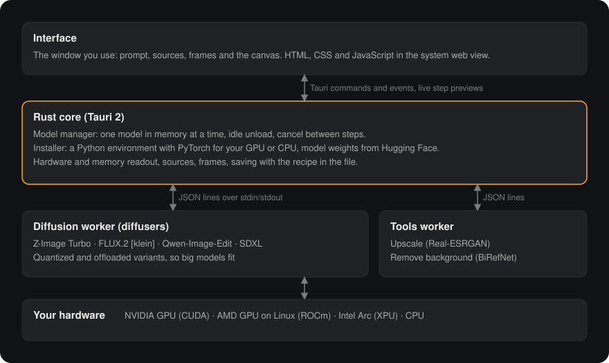

# Latent plan

Status: plan only. Nothing here is built yet. Written 2026-10-20.
Section 5 is the contract between the interface and the backend: build against it, and change it here first.

## 1. What this app is, and who it's for

One person (Mason) making and editing images on one 16 GB GPU (RTX 5070 Ti), with models that can't all be loaded at once.
The job: **write a prompt or drop in a photo, pick a model, watch it develop, iterate, keep the best frame.**

Latent is Mimic's sibling. Same stack, same rules (one model in memory, nothing leaves the PC, nothing saved behind your back),
same look. What changes is the material: images are big, slow to make, and best judged side by side.

What existing local tools get wrong (ComfyUI, Forge, Fooocus, InvokeAI):
- **Node graphs or walls of sliders** come first. Most runs need a prompt, a size and a model; everything else is a detail.
- **Memory is invisible.** You learn a model doesn't fit when it crashes, or when it quietly offloads and takes 4 minutes.
- **Editing is a separate app or tab.** Turning a result into the input for the next edit takes a download and an upload.
- **Progress is a percentage.** The image only appears at the end, so a bad seed costs the whole run.
- **Python owns the window**, so a model crash takes the interface with it.

## 2. Stack decision

Same as Mimic, which already proved it on this machine:

| Layer | Choice | Why |
| --- | --- | --- |
| Shell | **Tauri 2** | ~10 MB installer, system web view, Rust supervises workers, signed auto-updates. Mimic's release workflow carries over. |
| Interface | **Plain HTML, CSS and JavaScript** in `app/ui`, fonts bundled, no framework, no component kit | What Mimic ships. No build step. Kits are where the generic look comes from. |
| Core | **Rust** | Process supervision, hardware readout, files, thumbnails, the one-model rule. Never imports a model. |
| Models | **Python workers on Hugging Face diffusers**, NDJSON over stdio | Every model on the list has a diffusers pipeline. One code path for loading, offloading, quantizing and step callbacks. |

Reused from Mimic nearly as is: `worker.rs` (job objects, process groups, kill tree, venv python), `hw.rs` (GPU detection
by PCI id, NVML/sysfs memory, ROCm/XPU), `install.rs` (uv venvs, PyTorch index per device), `device.py`, the updater, the
release workflow, the fonts, and the token and motion rules in the CSS.

**Not ComfyUI.** Wrapping it would mean shipping its node graph, its custom-node supply chain and its own server just to
run four pipelines. Diffusers gives the same models with a few hundred lines we control.

**One Python environment, not one per model.** Mimic needed one venv per engine because TTS libraries pin conflicting
versions. The diffusion models here all run on the same `torch` + `diffusers` + `transformers`, and a second copy of
PyTorch is about 4 GB. So: `diffusion-env` for every model and tool. A model that ever needs incompatible versions gets
its own env then, not before. The cost: upgrading diffusers touches every model, so the version is pinned and bumped on
purpose.

## 3. Design direction

### Metaphor
A darkroom, not a dashboard. A *latent image* is the picture on exposed film before it is developed.
Three nouns, the same shape as Mimic's Voices / Script / Takes:
- **Sources**: photos you bring in to edit from (the negatives).
- **Prompt**: what to make, or what to change.
- **Frames**: what came out, laid out like a contact sheet. Batches stay together.

The **canvas** shows one frame large. It is where a frame develops live, step by step, and where you compare an edit with
its source.

### The mode is what you give it
No Generate / Edit / Inpaint tabs.
- No source attached: the prompt makes a new image (text to image).
- A source attached: the prompt describes a change to it (edit). Models that take several references accept several.
- A mask painted on the source: only that area changes (inpaint, phase 3).

The model list filters itself to what can do the current job, from each model's declared capabilities (section 5).
**Use as source** (`E`) turns any frame into the next edit's input, which is the loop that matters: make, pick, refine.

### Layout (one screen, no tabs)

```
+------------------------------------------------------------------------------------------------+
| L Latent    Z-Image Turbo 12.4 GB warm   klein 4B 9.8 GB   Qwen Edit 15.1 GB   Models...       |
|             ##########################........................  9.8 of 15.9 GB VRAM  Settings |
+-------------+----------------------------------------------------------+-----------------------+
| SOURCES  2  |                                                          | FRAMES       6 unsaved|
|             |                                                          |                       |
| [photo] me  |                                                          |  Batch 3 . klein 4B   |
| [photo] dog |                  CANVAS                                  |  [####] [####]        |
|             |         the selected frame, large;                      |  [####] [ .. ]  14/28  |
| + Import    |         while generating it develops here               |                       |
|   or paste  |                                                          |  Batch 2 . Z-Image    |
|   or drop   |   [ source | result ] compare slider for edits           |  [####] [####]        |
|             |                                                          |                       |
|             +----------------------------------------------------------+  Batch 1 . Z-Image    |
|             | A lighthouse at dusk, wet stone, film grain              |  [####]               |
|             |                                                          |                       |
|             | [dog.jpg x]  4:5 1024x1280   4 frames   seed 41  Options | Save . Use as source  |
|             |                                       [ Generate Ctrl Enter ]                     |
+-------------+----------------------------------------------------------+-----------------------+
| Batch 3: frame 4 developing, step 14 of 28, 1.9 s per step              klein 4B unloads in 9:58|
+------------------------------------------------------------------------------------------------+
```

Below 1100 px wide, Sources collapses to a strip above the prompt. On phones (remote use, later) one panel at a time, like Mimic.

### Specific choices (and what they avoid)

| Choice | Avoids |
| --- | --- |
| Mimic's palette: graphite `#111213`, ink `#ECEDE9`; light theme cool paper `#F4F4F1`. Images are the only colour on screen, so the chrome stays neutral. | Gradients, glass, neon, anything that competes with the pictures |
| One accent, **safelight amber** (`#FFAA2C`, light theme `#C76A00`): Generate, the developing frame, the memory preview. Nothing else is amber. Mimic's red is its on-air light; amber is the darkroom's. | Accent sprinkled on every control |
| Prompt in Newsreader, large, like Mimic's script. UI in IBM Plex Sans, tabular figures for every number. | Inter everywhere, monospace "AI" look |
| **The memory bar is the model picker.** Hover a model and its footprint is outlined on the bar, with what has to unload first. Quantized variants show their own footprint. | A dropdown that hides the constraint the app lives with |
| **Frames develop in place.** Step previews replace the placeholder in the same tile and on the canvas. No spinner, no fake percentage. | "Generating..." and a bar, then a surprise |
| Contact sheet grouped by batch, with the recipe (model, size, seed, steps) one hover away and one key to reuse (`R`). | An endless undifferentiated gallery |
| Edits open in a before/after slider on the canvas; hold `\` to flip. | Judging an edit without seeing the original |
| Sizes as aspect chips (1:1, 4:5, 3:2, 16:9, 9:16) mapped to each model's native resolutions. Exact pixels under Options. | Free width/height boxes that produce off-distribution sizes |
| Options drawer (steps, guidance, sampler, negative prompt) is per model and shows only what that model uses. Changed values get a dot, like Mimic's Controls. | A sampler dropdown on a distilled 8-step model that ignores it |
| Labels are domain words: Sources, Frames, Develop, Warm, Cold, Unload. | "Unleash your creativity", sparkle icons |
| Every number is measured: memory from NVML or sysfs, seconds per step from the run. | Placeholder stats |

### Motion
Same rules as Mimic: nothing animates on keyboard actions; press feedback `scale(0.97)` 120 ms; panels under 200 ms on
`cubic-bezier(0.23, 1, 0.32, 1)`; only `transform` and `opacity`; `prefers-reduced-motion` drops movement.
One Latent-specific moment: when a frame finishes, its last preview cross-fades to the full image over 180 ms. That is the
print coming up, and it is the only flourish.

### Keyboard
`Ctrl+Enter` generate · `Esc` cancel the batch · arrows or `1-9` move between frames · `E` use as source ·
`V` more like this (same recipe, new seeds) · `R` reuse recipe · `\` hold to compare with source · `F` fit / 100% ·
`Ctrl+V` paste an image as a source · `Ctrl+S` / `Ctrl+Shift+S` save / save as · `Delete` drop frame ·
`Ctrl+K` command palette · `Ctrl+,` settings.

## 4. Architecture

<picture></picture>

```
 Interface (app/ui)  <-- Tauri commands / events -->  Rust core  <-- NDJSON over stdio -->  diffusion worker (diffusers)
 canvas, contact sheet,       asset:// for images     - model manager (one resident)          tools worker (upscale, cutout)
 develop previews                                     - installer (uv, HF downloads)
                                                      - hardware + memory poll
                                                      - sources, frames, thumbnails
```

### Rules that make it feel fast
1. **Window opens before anything loads.** The last model warms in the background if the setting is on; the bar says `cold` honestly.
2. **One resident model.** Loading another unloads the current one first, and the bar shows it move. The tools worker is small and runs beside it only when both fit, otherwise the model unloads first.
3. **Idle unload** after N minutes (default 10) gives the GPU back.
4. **Previews every step.** The worker decodes a small preview each step (tiny autoencoder where one exists, otherwise a linear latent-to-RGB projection) and writes a 256 px JPEG. Cost must stay under 5% of a step; phase 0 checks this per model.
5. **Cancel without unloading.** Cancel stops the pipeline at the next step boundary; the model stays warm. Killing the process is the fallback after 10 s.
6. **Out of memory is a state, not a crash.** The worker catches it, frees the cache, stays loaded, and the UI offers the fix that applies (smaller size, fewer frames per batch, a lighter variant).
7. **Thumbnails are made once** in Rust when a frame lands, so the contact sheet never decodes full PNGs.
8. **Batches run one frame at a time** by default (lower peak memory, the first frame shows sooner). Models that batch cheaply can declare it.

### Memory: variants, not settings
Each model ships a few **variants** chosen in Models, each with a measured footprint: `bf16` (full), `fp8` or `nf4`
(quantized), and an offloading mode (`model` CPU offload, or `group` offloading to RAM for the big ones). Latent picks the
fastest variant that fits this PC and says so; the user can override. No "advanced memory" checkboxes.

## 5. Backend contract

The interface is built only against this. The backend owns everything below the line.

### Tauri commands (`invoke`)

| Command | Args | Returns | Notes |
| --- | --- | --- | --- |
| `bootstrap` | | `{ version, settings, hw, models, sources, frames, resident }` | Everything the first paint needs, in one call |
| `save_settings` | `settings` | `settings` | |
| `models` | | `Model[]` | Catalog + install state + fit verdict for this PC |
| `install_model` | `id, variant` | `Model` | Streams `install` events. Resumable. |
| `remove_model` | `id` | `Model` | |
| `preload` | `model, variant` | | Warms a model; `engine` events report state |
| `unload` | | | |
| `generate` | `GenRequest` | `{ batch }` | Returns at once with the batch id; results arrive as events |
| `cancel` | `batch` | | |
| `import_sources` | `paths?: string[]` | `Source[]` | No paths: opens the file dialog. Accepts drag-and-drop paths. |
| `paste_source` | `png: string` (base64) | `Source` | Clipboard images |
| `frame_to_source` | `frame` | `Source` | "Use as source" |
| `delete_source` | `id` | | |
| `run_tool` | `{ tool: "upscale" \| "cutout", input: { frame } \| { source }, scale? }` | `{ batch }` | Results arrive as `frame` events in their own batch |
| `save_frame` | `id` | `path` | To the save folder, unique name |
| `save_frame_as` | `id` | `path \| null` | Save dialog: PNG, WebP or JPEG |
| `delete_frame` | `id` | | |
| `reveal` | `path` | | Show in Explorer / file manager |
| `check_update`, `install_update` | | | As in Mimic |

### Events (`listen`)

| Event | Payload |
| --- | --- |
| `hw` | `{ device, vram: { used, total } \| null, ram: { used, total } }` every second while the window is visible |
| `engine` | `{ model, variant, state: "cold" \| "loading" \| "warm" \| "busy" \| "unloading" \| "crashed", elapsed?, message? }` |
| `progress` | `{ batch, index, step, steps, preview?: path, secPerStep }` |
| `frame` | `Frame` (a finished frame) |
| `batch` | `{ batch, state: "done" \| "cancelled" \| "failed", error?: { kind: "oom" \| "model" \| "input", message, fix? } }` |
| `install` | `{ id, phase: "env" \| "torch" \| "weights" \| "verify" \| "done" \| "failed", done?, total?, message? }` |

### Types

```ts
GenRequest = {
  model: string, variant?: string,
  prompt: string, negative?: string,       // negative only for models that declare it
  sources: string[],                       // source ids; empty = text to image
  mask?: string,                           // PNG path, white = change (phase 3)
  width: number, height: number,           // already snapped to the model's grid by the UI
  count: number,                           // frames in the batch, 1-8
  seed: number | null,                     // null = random; frame i uses seed + i
  options: { steps?, guidance?, sampler?, strength? }  // only keys the model declares
}

Frame = { id, batch, index, path, thumb, width, height, seed, recipe: GenRequest, model, variant,
          elapsed, saved: string | null, createdAt }
Source = { id, path, thumb, width, height, name, fromFrame?: string }

Model = { id, name, family, license, licenseUrl, commercial: boolean,
          can: { generate, edit, inpaint, multiRef, negative },
          sizes: [w, h][], grid: 16 | 64,
          options: { steps: {min,max,default}, guidance?: {...}, sampler?: string[] },
          variants: [{ id, label, vram, ram, disk, installed, fits: "yes" | "tight" | "no" }],
          installed: boolean, defaultVariant }
```

Frames carry their full recipe, so any frame can be regenerated or varied from its row.

### Worker protocol (NDJSON, one JSON object per line)

The worker is started as `python -X utf8 engines/diffusion_worker.py <model> <variant>` with `LATENT_DEVICE`,
`HF_HOME` (inside the models folder) and `LATENT_CACHE` set. Library output goes to stderr (the log), as in Mimic's workers.

```jsonc
// worker -> core, once loaded
{"event":"ready","model":"z-image-turbo","variant":"bf16","device":"cuda","fallback":null,"vram":12.4}

// core -> worker
{"op":"generate","id":"b3-0","prompt":"...","sources":["C:/.../src.png"],"mask":null,
 "width":1024,"height":1280,"seed":41,"options":{"steps":28,"guidance":3.5},"output":"C:/.../b3-0.png"}
{"op":"cancel","id":"b3-0"}

// worker -> core
{"event":"progress","id":"b3-0","step":14,"steps":28,"preview":"C:/.../b3-0.p.jpg","sec_per_step":1.9}
{"event":"done","id":"b3-0","output":"C:/.../b3-0.png","seed":41,"elapsed":53.2}
{"event":"cancelled","id":"b3-0"}
{"event":"error","id":"b3-0","kind":"oom","message":"CUDA out of memory (tried 2.1 GB)"}
```

- The worker reads stdin on its own thread, so `cancel` lands mid-run; the step callback sets the pipeline's interrupt flag.
- One request at a time. The core queues a batch's frames and sends the next one when `done` arrives.
- Mimic's `Worker::request` waits for `done` and drops everything else. Latent needs `request_stream(req, on_event)`
  that forwards `progress` to the UI, and the child's stdin behind its own lock so `cancel` can be written during a request.
- The worker writes PNGs with the recipe in a `parameters` text chunk and `Software: Latent` plus an
  `ai_generated: true` marker. Save keeps that metadata; WebP and JPEG get it as XMP.

### Data

| | Windows | Linux |
| --- | --- | --- |
| Models folder (env, weights, `HF_HOME`) | `%USERPROFILE%\latent` | `~/.local/share/latent/models` |
| Settings, sources, frame index | `%APPDATA%\com.mazon.latent` | `~/.local/share/com.mazon.latent` |
| Frame cache (cleared on close) | `%LOCALAPPDATA%\com.mazon.latent\cache` | `~/.cache/latent` |
| Save folder (default) | `Pictures\Latent` | `~/Pictures/Latent` |

Sources are copied in on import (so moving the original doesn't break a recipe) and resized to at most 2048 px on the
long side. `.gitignore` keeps generated images, sources, models and logs out of the repo.

## 6. Models

Figures are third-party estimates until phase 0 measures each one on the 5070 Ti and on the CPU; the app then records the
real peak the first time a model loads, as Mimic does.

| Model | Does | Size | Memory (estimate) | License | Tier |
| --- | --- | --- | --- | --- | --- |
| **Z-Image Turbo** | generate | 6B, 8 steps | ~12-16 GB bf16; less quantized | Apache 2.0 | default on 16 GB |
| **FLUX.2 [klein] 4B** | generate, edit, multi-reference | 4B | ~8-13 GB | Apache 2.0 | default editor, 12 GB+ |
| **Qwen-Image-Edit** | edit (strong on text and objects) | 20B | 20 GB+ bf16; fits 16 GB only quantized + offloaded | Apache 2.0 | 16 GB, quantized |
| **SDXL 1.0** (+ community checkpoints, phase 3) | generate, inpaint | 3.5B | ~7-8 GB; CPU possible but slow | CreativeML OpenRAIL++-M | 8 GB GPUs, CPU |
| FLUX.2 [klein] 9B | generate, edit | 9B | ~20 GB+ unquantized | check model card (non-commercial terms) | later |
| FLUX.2 [dev] | generate, edit | 32B | 24 GB+ even at 4-bit | FLUX non-commercial | large GPUs only, later |
| **Real-ESRGAN x4plus** (tool) | upscale 2x / 4x | 17M | < 1 GB | BSD-3 | everyone |
| **BiRefNet** (tool) | remove background | ~220M | ~1-2 GB | MIT | everyone |

To check in phase 0: a credible CPU tier (SDXL with a few-step distillation, or a small model like Sana Sprint; licenses
to confirm), whether klein's edit quality makes Qwen-Image-Edit unnecessary on 16 GB, and Blackwell (sm_120) support,
which needs PyTorch built for CUDA 12.8 or newer (Mimic's installer already picks that index).

## 7. Features, in priority order

1. **Generate with live development.** Prompt, aspect, count, seed; frames develop in place; cancel keeps the model warm.
2. **Models and memory bar.** Install, remove and pick models and variants; fit verdicts; idle unload; real readout.
3. **Sources and editing.** Import, paste, drop; attach to the prompt; before/after on the canvas; **use as source** from any frame.
4. **Frames stay in a cache until saved**, like Mimic's takes. Save, save as, unsaved count, warning on close. The recipe is in the file.
5. **Recipes.** Reuse (`R`), more like this (`V`), copy the recipe, open a saved PNG to load its recipe.
6. **Tools.** Upscale and remove background, on any frame or source.
7. **Inpaint.** Brush a mask on the canvas over a source; only that area changes.
8. **Compare models.** One prompt through every installed model that fits, one at a time, as labelled batches.
9. Later: LoRAs and community SDXL checkpoints, use from another device (Mimic's remote mode), command palette extras.

### Settings (top-right, Ctrl+,)
- **Appearance:** theme (dark / light / system; Caelestia on Linux as in Mimic).
- **Saving:** save folder, format (PNG / WebP / JPEG), file-name pattern, warn about unsaved frames on close.
- **Models and memory:** models folder, idle unload (5 / 10 / 30 min / never), warm the last model at start, run models on (Automatic / GPU / CPU), Hugging Face token for gated models.
- **Generation defaults:** frames per batch, default aspect.

## 8. States the design must cover

| Area | States |
| --- | --- |
| Model | not installed · installing (phase, bytes) · cold · loading (elapsed) · warm · busy · unloading · crashed · doesn't fit |
| Frame | queued · developing (step n of N, preview) · done · failed (reason + retry) · cancelled |
| Batch | running (k of n) · done · cancelled · out of memory (with the fix) |
| Source | importing · ready · too small for the model (warn) · unsupported file |
| Generate button | ready · no model installed · model can't edit (source attached) · prompt empty · busy (Esc to cancel) |
| Empty | no models (one recommended for this PC, one click) · no frames yet · no sources (drop zone) |
| Hardware | no GPU (CPU tier only, says so) · driver missing (package to install, from Mimic's `hw.rs`) · low disk for a download |

## 9. Phases

**Phase 0: mockup and spike (go / no-go).**
- `design/mockup.html`: the main screen in both themes, with real images, every state in section 8 reachable from a debug menu. Settles type, density and the contact sheet before real code.
- Spike: Tauri window + `diffusion_worker.py` running Z-Image Turbo and klein 4B with step previews and cancel.
- Measure on the 5070 Ti and on the CPU: load time, seconds per step, peak VRAM/RAM per variant, preview cost.
- Gate: the first preview appears within 2 s of pressing Generate on a warm model.

**Phase 1: generate.** Rust core from Mimic's modules, installer, model manager, generate loop, contact sheet, canvas, save.

**Phase 2: edit.** Sources, paste and drop, use as source, before/after, klein and Qwen-Image-Edit, recipes.

**Phase 3: tools and polish.** Upscale, remove background, inpaint mask, compare models, command palette, Linux AMD/Intel.

**Phase 4: ship.** First-run model recommendation, crash recovery, installer and release workflow, README screenshots and demo.

### Who builds what
- **Interface, design, README, brand** (this side): `app/ui`, `design/`, `docs/`.
- **Backend** (the other agent): `app/src-tauri` and `engines/`, against section 5. Start from Mimic's `worker.rs`, `hw.rs`,
  `install.rs` and `store.rs`, then add `request_stream`, the cancel path, the frame cache and thumbnails.
- Until the backend lands, `app/ui` runs against a fake backend (`app/ui/dev/mock.js`) that implements section 5 with canned images and timed `progress` events, so the two sides never block each other.

## 10. Risks

- **Memory figures are soft.** Sources disagree by 2x. Phase 0 measures; the fit verdicts come from measurements, not from this table.
- **Diffusers churn.** New models need new diffusers releases. One pinned env makes upgrades a deliberate step; the worker logs the version.
- **Licenses differ per model.** Each model shows its license and whether commercial use is allowed before download, and the NOTICE lists them.
- **Disk.** Models are 8-40 GB each. Models shows download size and free space before anything starts.
- **Misuse.** Editing photos of real people can be abused. See the open decisions; the README's Responsible use section states the line either way.
- **Preview cost** on models without a tiny autoencoder. Fallback is the linear projection, which is free but blurry; acceptable, because it only needs to show composition early.

## 11. Open decisions for the user

1. **Frames:** keep Mimic's rule (cache until saved, cleared on close), or keep a persistent history? Recommended: Mimic's rule, for privacy and consistency; a closed window loses nothing you saved.
2. **Content policy:** no built-in content filter (like other local tools; each model's license applies), plus a one-time notice before the first edit of a photo, like Mimic's clone consent. Or an optional safety filter. Recommended: the notice, no filter.
3. **Accent:** safelight amber (as drawn), or Mimic's red so the two apps match exactly?
4. **Linux AMD and Intel at launch,** or NVIDIA and CPU first and the rest in phase 3? Recommended: phase 3; `hw.rs` already detects them, but each model needs testing.
5. **LoRAs and community checkpoints:** in scope at all? Recommended: phase 3, SDXL and klein only.
